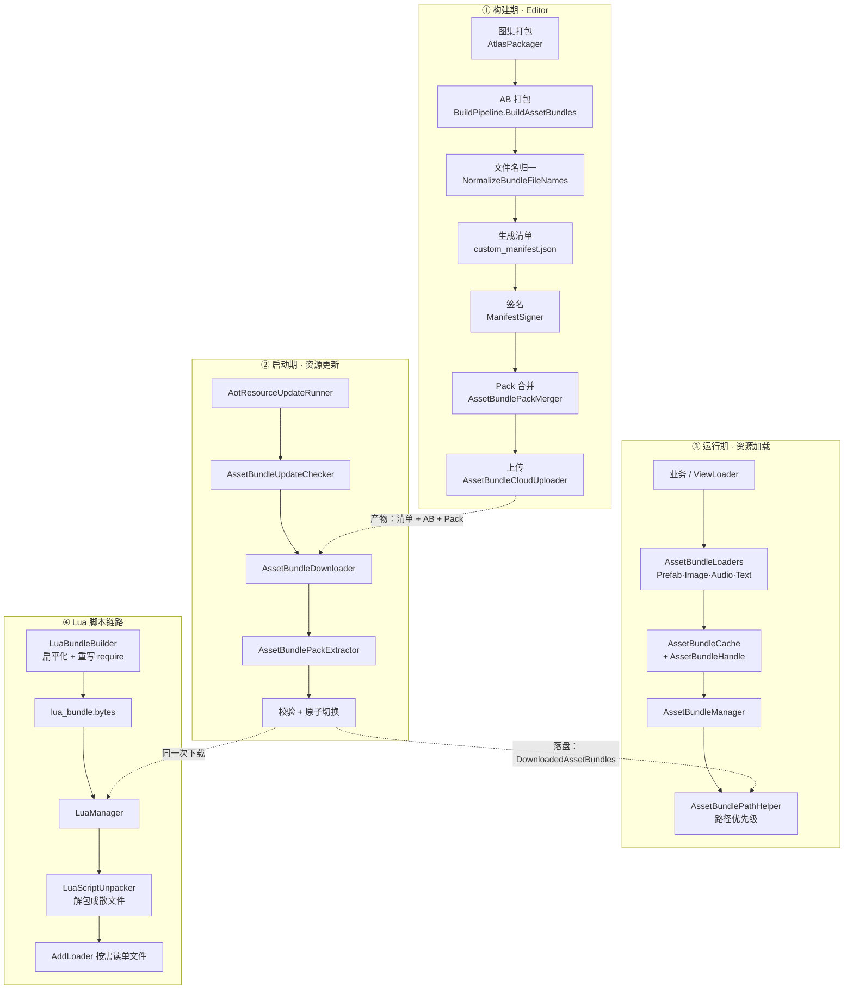
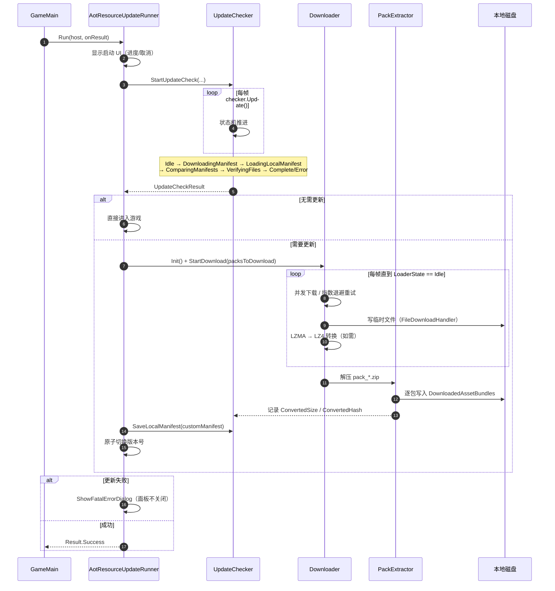
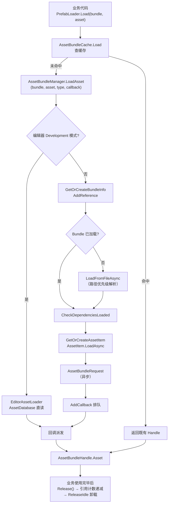
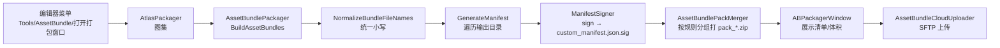
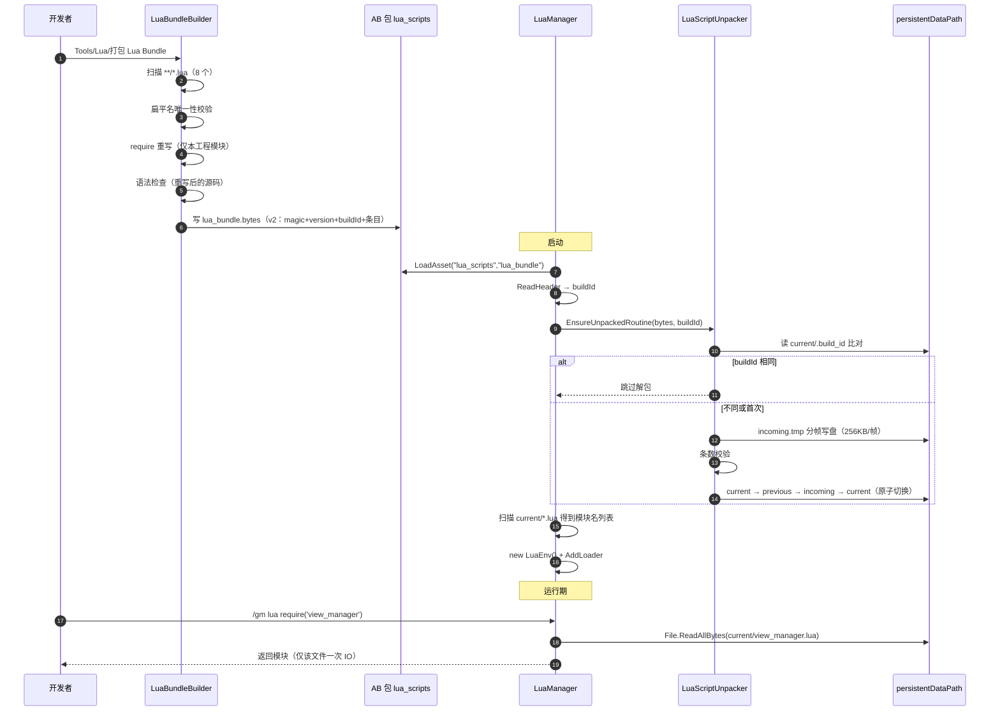
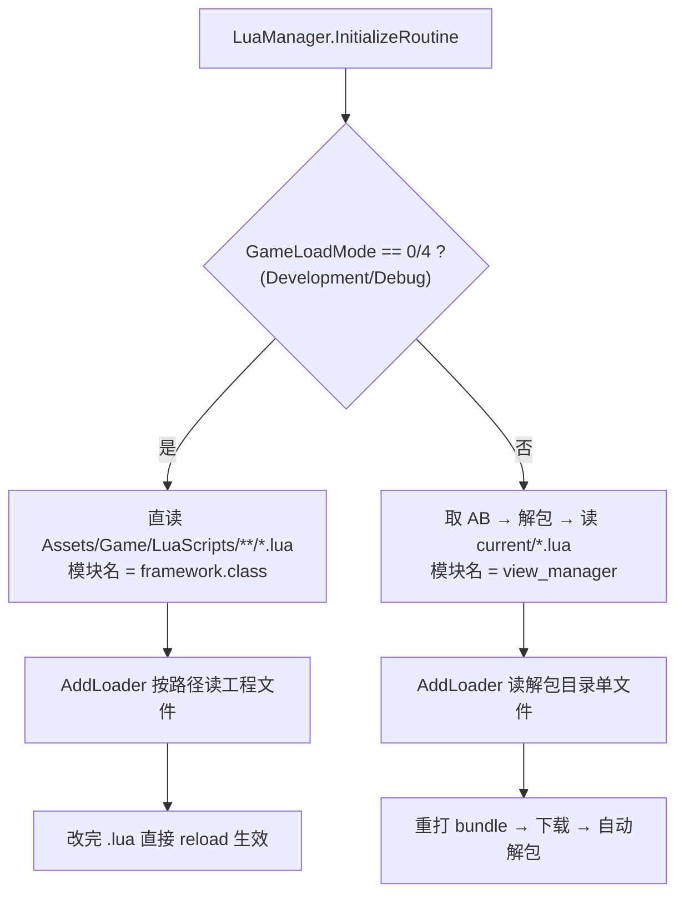

# CarrotFantasy AssetBundle 框架 —— 结构与流程

| 项目 | 内容 |
|---|---|
| 状态 | **现状快照**（供评审用，不是设计稿） |
| 编写日期 | 2026-10-18 |
| 代码基线 | `8f5926e` 之后（已移除 HybridCLR、程序集 9→6、Lua 热更接入方案 B） |
| 覆盖范围 | 构建期管线、启动期更新、运行时加载、Lua 脚本链路 |
| 关联文档 | `Lua热更-改造计划与验收.md`、`AB框架-问题清单与改进建议.md`、`构建与热更-操作手册.md` |

> 本文只描述**现在是什么样**，以及基于现状整理的**缺口清单**（§6）。改进方案另开设计文档。

---

## 1. 全景：三条链路

框架实际上由三条相对独立的链路组成，共用同一份清单（`custom_manifest.json`）与同一套包（AssetBundle + Pack）。



---

## 2. 模块结构

### 2.1 构建期（`Assets/Editor/BuildEditor/`）

| 模块 | 行数 | 职责 |
|---|---|---|
| `AtlasPackager` | 331 | 按目录生成 SpriteAtlas 并打包 |
| `PrefabABPathPostprocessor` | 244 | 按路径规则给资产分配 `assetBundleName`（含 Lua Bundle 规则） |
| `AssetBundleBuildSettings` | 240 | 输出根目录、压缩格式、清单版本号 |
| `AssetBundlePackager` | 564 | 调用 `BuildAssetBundles`、文件名小写、生成清单、依赖收集 |
| `AssetBundlePackMerger` | 297 | 按 `PackGroupingDefaults` 规则把 AB 合并成 `pack_*.zip` |
| `ManifestSigner` | 89 | RSA-2048 / SHA-256 对清单签名 |
| `AssetBundleCloudUploader` | 501 | SFTP 上传（全量 / 增量白名单） |
| `ABPackagerWindow` | 399 | 打包窗口（打包 → 看清单 → 上传） |
| `AssetBundleBuildPipeline` | 127 | 打包流水线编排（供 CLI 调用） |
| `LuaBundleBuilder` | 435 | **新增**：扁平化 + require 重写 + 语法检查 → `lua_bundle.bytes` |

### 2.2 启动期（`Assets/Scripts/Framework/`）

| 模块 | 行数 | 职责 |
|---|---|---|
| `AotResourceUpdateRunner` | 396 | 更新流程编排 + 启动 UI（进度/错误面板） |
| `AssetBundleUpdateChecker` | 1356 | 清单下载/比对/校验状态机 |
| `AssetBundleDownloader` | 1657 | AB 与 Pack 下载、LZMA→LZ4 转换、重试/并发/进度 |
| `AssetBundlePackExtractor` | 441 | 解压 `pack_*.zip`、逐包落盘并记录校验信息 |
| `AtomicFile` | 74 | 原子写（`Flush(true)` + 零字节拒绝 + rename） |
| `ManifestSignature` | 117 | 客户端侧验签（支持开发期跳过宏） |
| `DownloadPackPlanner` | 78 | 决定"下 Pack 还是下单个 AB" |
| `PackGroupingDefaults` | 100 | BootBundles 列表、独立 Pack 规则、Pack 体积阈值 |
| `AssetBundleCacheCleaner` | 225 | 清缓存（先卸载再删文件） |

### 2.3 运行期加载（`Assets/Scripts/Framework/` + `Assets/Scripts/Util/AssetBundle/`）

| 模块 | 行数 | 职责 |
|---|---|---|
| `AssetBundleManager` | 1951 | 核心：Bundle 注册表、AssetItem、引用计数、加载回调、依赖检查、卸载 |
| `AssetBundlePathHelper` | 277 | 运行时路径优先级（persistent → file:// → StreamingAssets） |
| `AssetBundleRuntimeConfig` | 24 | 读 `ab_runtime_config.json`（服务器模板 / env） |
| `EditorAssetLoader` | 215 | 编辑器 Development 模式直读 AssetDatabase |
| `AssetBundleLoaders` | 229 | 分层加载器：Prefab / Image / Audio / Text |
| `AssetBundleCache` | 501 | 句柄缓存、空闲释放、失败记忆 |
| `AssetBundleHandle` | 173 | 句柄：`IsDone / Succeeded / Asset / Completed / Release` |
| `AssetBundleScope` | 194 | 作用域批量释放（战斗/界面） |
| `AtlasLoader` | 512 | 图集级加载（Sprite 按 atlas 聚合） |

### 2.4 Lua 链路（`Assets/Scripts/Framework/Lua/`）

| 模块 | 行数 | 职责 |
|---|---|---|
| `LuaManager` | 538 | LuaEnv 生命周期、双模式加载、GM 执行、reload |
| `LuaBundleReader` | 193 | bundle 格式 v2 解析（头 + 流式条目） |
| `LuaScriptUnpacker` | 330 | 解包成散文件、buildId 比对、分帧、原子切换、回滚 |

---

## 3. 流程图

### 3.1 启动期：资源更新（`AotResourceUpdateRunner.Run`）



### 3.2 运行期：加载单个资源



**路径优先级**（`AssetBundlePathHelper`）：

| 优先级 | 位置 | 说明 |
|---|---|---|
| 1 | `persistentDataPath/DownloadedAssetBundles/` | 热更下载产物 |
| 2 | Build 输出（`file://` 模板） | 仅编辑器：`ab_runtime_config.json` 指向的目录 |
| 3 | `StreamingAssets/AssetBundles/<platform>/` | 包内基线（首次启动兜底） |

### 3.3 构建期：打包



### 3.4 Lua 脚本链路（方案 B）



### 3.5 编辑器双模式对照



---

## 4. 关键数据结构

```
custom_manifest.json
├─ AppVersion          （服务端写入；客户端只把它当参考，不再用于清库判断）
├─ ManifestVersion     （自增，用于清单比对与原子切换）
├─ BuildTime / buildTime
├─ CompressedFormat    （0=LZMA 1=LZ4 2=无压缩）
├─ AssetBundles[]      CustomAssetBundleInfo
│   ├─ AssetName / BundleName
│   ├─ Hash（源文件 MD5）/ Size / Version
│   ├─ Dependencies[]（扁平依赖列表）
│   └─ ConvertedSize / ConvertedHash（LZMA→LZ4 后的落盘信息，仅本地清单）
└─ DownloadPacks[]     DownloadPackInfo
    ├─ PackName / PackFileName / PackSize / PackHash
    ├─ BundleNames[]
    └─ Critical（关键包失败则整次更新失败）
```

运行时对象：

```
BundleInfo（AB 级）
├─ AddReference / RemoveReference
├─ GetOrCreateAssetItem(assetName)
├─ CheckDependenciesLoaded / OnDependencyLoaded
└─ Unload(unloadAllLoadedObjects)

AssetItem（资产级）
├─ referenceCount
├─ AssetBundleRequest loadRequest
└─ AddCallback / ExecuteCallbacks

AssetBundleHandle<T>
├─ IsDone / Succeeded / Asset
├─ Completed 事件
└─ Release() / Dispose()
```

---

## 5. 现有能力清单（已具备）

| 能力 | 证据 |
|---|---|
| 清单版本比对 + 增量下载 | `AssetBundleUpdateChecker` 状态机 |
| 本地文件完整性校验（MD5） | `VerifyingFiles` 阶段 + `CheckBundleIntegrity` |
| 清单 RSA 签名 + 客户端验签 | `ManifestSigner` / `ManifestSignature` |
| LZMA → LZ4 落盘转换 | `AssetBundleDownloader` / `PackExtractor` |
| Pack 合并下载（减少请求数） | `AssetBundlePackMerger` + `DownloadPackPlanner` |
| **指数退避 + 抖动重试** | `AssetBundleDownloader.cs:1106`（min(30s, 2^n) + jitter） |
| 并发下载 + 优先级 | `LoadPriority`（Low/Medium/High/Sync/Max） |
| 原子写文件 | `AtomicFile`（`Flush(true)`、拒绝 0 字节、rename） |
| 原子切换版本 | 临时目录 → 校验 → 切换 |
| 引用计数 + 空闲卸载 | `BundleInfo` / `AssetItem` / `AssetBundleCache` |
| 作用域批量释放 | `AssetBundleScope` |
| 编辑器直读（免打包） | `EditorAssetLoader` |
| 首次安装用 StreamingAssets 基线 | `AssetBundleUpdateChecker` 首装分支 |
| Lua 脚本走 AB + 解包按需读 | 本会话新增（方案 B） |

---

## 6. 缺口与待改（评审重点）

> 按「影响 × 修复成本」排序。**优先级 P0 = 线上风险，P1 = 体验/健壮性，P2 = 优化**。

### 6.1 P0 —— 会让线上出问题的

| 编号 | 问题 | 证据 | 影响 | 建议 |
|---|---|---|---|---|
| G1 | **断点续传未实现** | `AssetBundleDownloader.cs:876-880` 整段 `SetRequestHeader("Range", ...)` **被注释掉** | 下载中断后必须整包重下；大包/弱网下失败率与流量显著上升 | 恢复 Range 逻辑：本地已下载字节数 → `bytes=N-` → 服务端需支持 206；完成后整体 MD5 校验 |
| G2 | **无差分更新** | 全项目 `bsdiff`/`hdiff` 命中 0 处 | 每次热更都传全量；包越大流量成本越高 | 引入 hdiff（或业务层对 Pack 做 bsdiff），差分包 > 全量时自动降级全量 |
| G3 | **回滚能力缺失** | 未见 N-1 版本目录保留逻辑 | 新版本热更出问题只能等下一次热更，无法快速回退 | 保留 `DownloadedAssetBundles` 的 N-1，清单里带 `canRollbackTo`，启动失败时回退 |
| G4 | **清单验签的信任根硬编码在客户端** | `ManifestSignature.cs` 里的 `PublicKeyXml` | 私钥泄露或需更换密钥时必须发新包 | 属常见取舍，但应在 SOP 里明确"密钥不可轮换"约束，并考虑支持密钥版本号 |
| G5 | **Lua Bundle 未接入 AB 打包流水线** | `LuaBundleBuilder` 只有菜单入口，`ABPackagerWindow` 未调用 | 忘记先打 Lua Bundle 就打 AB → 包里是旧脚本，且现象是"改了 Lua 没生效" | 在 `AssetBundleBuildPipeline` 打包前自动执行 `LuaBundleBuilder.Build`，失败则中止 |

### 6.2 P1 —— 健壮性与体验

| 编号 | 问题 | 证据 | 影响 | 建议 |
|---|---|---|---|---|
| G6 | Pack 中「非预期条目」零校验 | `AssetBundlePackExtractor` 按 `BundleNames` 白名单写盘，其余条目仅跳过 | 打包侧多塞文件不会报错，问题延迟到运行时 | 解包时统计"跳过条目数"，超过 0 就告警 |
| G7 | 下载超时的分级策略不明确 | `timeout` 命中 75 处，多为网络层 | 弱网下可能出现"卡很久才失败" | 定义三档：连接超时 / 单包空闲超时 / 整批总超时，并在 UI 上可见 |
| G8 | 缓存清理不删空目录 | `AssetBundleCacheCleaner` | 长期运行会留下大量空目录 | 清理后自底向上删空目录 |
| G9 | Lua 解包目录无容量上限 | `LuaScriptUnpacker` 只做版本切换，不统计总占用 | 极端情况（大量历史残留）占磁盘 | 切换后统计 `current` 体积；超过阈值告警；非 current 目录一律清 |
| G10 | Lua 首次 `require` 同步读未做预热 | `LuaManager.CustomLoader` 直接 `File.ReadAllBytes` | 大配置表首次加载可能 1~5ms 卡顿 | 加 `PreloadAsync(names)`，在 loading 界面分批预热热点模块 |
| G11 | 平台覆盖不足 | `Plugins/Android` 无 `libxlua.so`；iOS 未验证 | 无法出 Android/iOS 包 | 补原生库 + 一次 Android 出包验证 |

### 6.3 P2 —— 优化与工程化

| 编号 | 问题 | 建议 |
|---|---|---|
| G12 | Lua 只有一个包，规模大了会变成"大包全量" | 按目录拆 `lua_core` / `lua_business` / `lua_config`，用 `EnsureBundleLoaded` 按需加载 |
| G13 | 清单字段缺少渠道 / 分组信息 | 若要多渠道，清单加 `Channel` 维度，服务端按渠道下发 |
| G14 | 无灰度能力 | 客户端侧预留 `ab_runtime_config` 的灰度开关字段，服务端控制下发比例 |
| G15 | 打包/上传缺少 CI 自动化 | `unity-batch.ps1` 增加 `-cfCommand=abBuild + upload` 组合，并接入 `check-lua-syntax.ps1` |

---

## 7. 建议的修改顺序

```text
第一批（半天，风险最低）
  G5  Lua Bundle 接入打包流水线      —— 消除"改了没生效"这类低级事故
  G6  Pack 非预期条目告警
  G8  清缓存删空目录

第二批（1~2 天，体验提升）
  G1  断点续传（Range）
  G7  超时分级
  G10 Lua 预热接口

第三批（2~3 天，需要更多测试）
  G3  回滚（N-1 保留 + 启动失败回退）
  G2  差分（hdiff）

第四批（按需）
  G11 Android/iOS 出包验证
  G12 Lua 拆多包
  G14 灰度
```

---

## 8. 附图说明：为什么「更新」和「加载」必须分开看

很多人把这两件事混在一起，导致排查困难。在本框架里它们的边界很清楚：

| | 启动期更新 | 运行期加载 |
|---|---|---|
| 触发 | 每次启动（`AotResourceUpdateRunner`） | 业务按需（`Loader.Load`） |
| 输入 | 远程清单 vs 本地清单 | bundle 名 + 资源名 |
| 关键动作 | 下载、解包、校验、切换 | 打开 AB、取资产、回调、引用计数 |
| 失败表现 | 进度卡住 / 错误面板 | 资源为空 / 界面缺图 |
| 排查入口 | `custom_manifest.json` + 下载日志 | `AssetBundleManager` 日志 + `resdump` GM 指令 |

排查时先确认"包到没到位"（更新层），再确认"有没有被正确加载/释放"（加载层），能省掉大量时间。

---

## 变更记录

| 日期 | 版本 | 说明 |
|---|---|---|
| 2026-10-18 | v1 | 初稿。基于 `8f5926e` 之后的代码状态，覆盖构建期/启动期/运行期/Lua 四条链路与 15 项缺口 |
