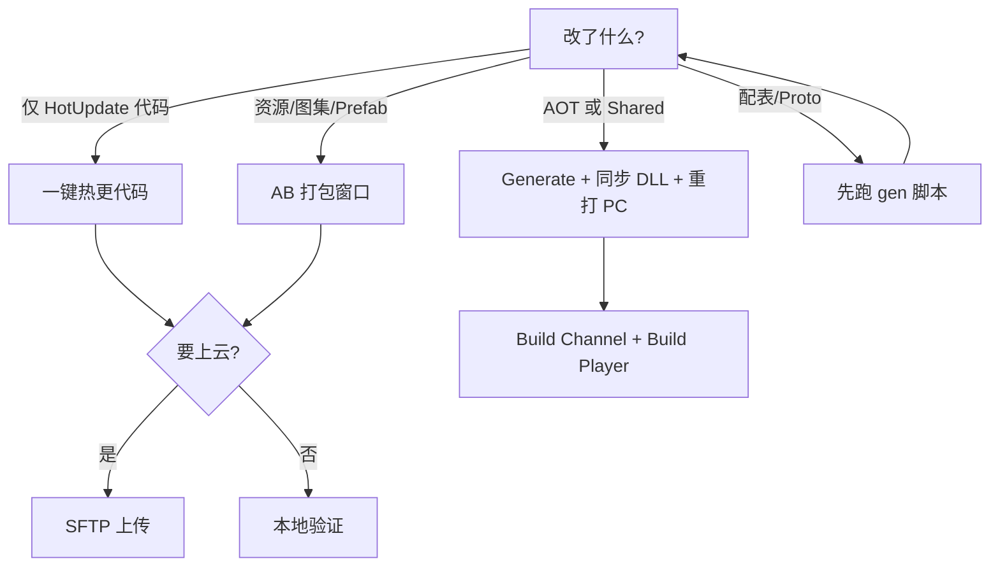

# CarrotFantasy 构建与热更 SOP

日常发布与本地迭代按本文操作。根 `README` 仅为项目简介，不覆盖本流程。

## 1. 心智模型

启动链路：

`GameMain`(AOT) → 资源更新(AB + HybridCLR DLL) → `HotUpdateEntry`(业务)

| 程序集 | 改动后通常要做什么 |
|--------|-------------------|
| `HotUpdate` | 代码热更即可，**不必**重打 PC 包 |
| `AOT` / `Shared` | 需要重打 PC Player；RebuildAdvisor 会提示 |
| 资源 / Prefab / 图集 | 走 AB 完整打包（可上传） |
| 配表 / Proto | 先跑外部脚本生成，再进 Unity |

默认产物目录：

- AB：`CarrotFantasy/Build/AssetBundles/{平台}/`
- PC 包常见：`CarrotFantasy/Build/PC/`
- 运行配置：`StreamingAssets/ab_runtime_config.json`（`env` = `dev` / `staging` / `prod`）

## 2. 日常场景速查

### A. 只改热更业务代码（最常用）

前置：该平台至少完整打过一次 AB（目录里要有 `hybridclr/` 等）。

1. `File → Build Settings`：激活平台与目标一致（如 Windows）
2. `Tools/HybridCLR/一键热更代码（Generate+同步+清单）`
3. 弹窗问是否上传 → 需要就上传（会传 `hybridclr/`、`packs/`、`custom_manifest.json`、`version.txt`）
4. 若弹出「是否需要重新打包 PC」：一般**只改 HotUpdate 可忽略**；AOT/Shared 变了才重打

### B. 改资源 / UI / Prefab

1. `Tools/AssetBundle/打开打包窗口`
2. 确认目标平台、版本号、CDN 模板
3. 建议勾选「构建前打包 UI 图集」
4. 执行构建（窗口内「构建」/强制重建）
5. 按需拷贝 StreamingAssets、询问上传
6. 同样可能触发 PC 重打建议（仅 AOT/Shared 变更时需理会）

### C. 改 AOT / Shared（启动壳、路径、宏相关）

1. 改完等编译
2. `Tools/HybridCLR/Generate All`（或走一键热更里的 Generate）
3. `Tools/HybridCLR/同步 DLL（StreamingAssets + AB 输出）`
4. 视情况刷新清单/Pack，或再跑一遍「一键热更代码」
5. **重打 PC 包**（见场景 E）
6. 打完后指纹会自动记录；也可手动：`Tools/HybridCLR/标记当前 AOT 已与 PC 包同步`

### D. 开发包 vs 正式包（PC）

| 目标 | 菜单 |
|------|------|
| 开发包（GM / 运行时 Log） | `Tools/Build Channel/准备开发 PC 包（启用 CF_DEV_TOOLS + env=dev）` |
| 正式包 | `Tools/Build Channel/准备正式 PC 包（禁用 CF_DEV_TOOLS + env=prod）` |
| **一键出包（推荐）** | `Tools/Build Channel/一键打开发 PC 包` / `一键打正式 PC 包` |
| 仅看状态 | `Tools/Build Channel/查看当前通道状态` |

一键出包会：写通道宏与 `env` →（若宏刚变则需等编译后再点一次）→ HybridCLR Generate/同步 DLL → `BuildPlayer`。

仅「准备」后也可手动：

1. 等待脚本编译完成
2. HybridCLR Generate + 同步 DLL
3. `File → Build Settings` 打 Windows 包

说明：`staging` 常量已有，菜单暂未单独暴露；Batch 可用 `-cfEnv=staging`（AB/热更），PC 一键出包目前只支持 `dev` / `prod`。

### E. 打 PC Player

**推荐**：场景 D 的一键菜单，或命令行 `.\Tools\pc-build.ps1 -Channel dev|prod`。

产物目录：`CarrotFantasy/Build/PC/{dev\|prod}/{yyyyMMdd-HHmmss}/CarrotFantasy.exe`  
（`productName` 为默认 `Unity` 时会改用 `CarrotFantasy.exe`）

校验：

- 开发包：`CF_DEV_TOOLS` 开、`env=dev`、Development Build
- 正式包：`CF_DEV_TOOLS` 关、`env=prod`、非 Development Build

成功后 `PcPlayerRebuildAdvisor` 会写指纹基线。

## 3. Editor 本地跑法

工具栏 / `GameLoadMode`（`LoadModeToolbarEditor`）：

| 模式 | 行为概要 |
|------|----------|
| Development / Debug | Editor 下**跳过**远程资源更新，方便本地迭代 |
| Testing | 可用本地 AB 清单，弱化远程依赖 |
| 其它 / Player | 走完整更新检查与下载 |

开发包 Player（带 `CF_DEV_TOOLS`）可进运行时 GM / Log 面板。

## 4. 配表与协议（Unity 外）

改表 / 改协议时，在进 Unity 或打热更前先生成：

- 配表（唯一入口）：`ConfigTools/gen_code_json.bat`（详见 `ConfigTools/说明.txt`）
  一次导出四份：C# 代码、JSON 数据、Lua 代码（schema）、Lua 数据。
- 协议：`Tools/regen-game-network.ps1` 或 `Proto/regen-game-network.bat`

### 配置表统一 list 模式（重要）

`ConfigTools/Config/Datas/__tables__.xlsx` 的 **mode 列必须全部填 `list`**。

| 侧 | 遍历（顺序 = Excel 行序） | 按 id 查 |
|---|---|---|
| C# | `table.DataList` | `GetBy<索引字段>(id)`，如 `TbTower.GetByTowerId(id)`；联合索引表仍是 `Get(a, b)` |
| Lua | 数据文件本身是有序数组，`for i = 1, #tbl do` | 自建索引，或走 `config_tables.lua` 的包装 |

**为什么不用默认的 map 模式**：map 模式导出的 Lua 是 `[id] = {...}`，
`pairs` 的遍历顺序不可依赖，Lua 侧还得额外拼 `DataList`，顺序无法保证。
list 模式下数据本身就是数组，顺序即 Excel 行序。

注意：`mode` 是**表级**设置，改了对 C# 与 Lua 同时生效。
生成物（C# / JSON / Lua）都入库，避免本地生成不一致。

说明：热更分两层——资源走 AssetBundle，代码走 Lua（xLua）。HybridCLR 已移除；
`Assets/ThirdParty/LitJson` 只是 JSON 库。

## 5. 常用菜单索引

| 分组 | 菜单 | 用途 |
|------|------|------|
| CarrotFantasy | `GM 工具` / `关卡刷怪表/…` | 业务 GM、刷怪表导入 |
| Build Channel | `准备…` / `一键打… PC 包` | PC 开发/正式通道与出包 |
| AssetBundle | `打开打包窗口` / `管理清单` / `图集打包` | AB 构建与本地目录 |
| AssetBundle | `重新分配所有资源包名` | 改了 AB 命名规则后重算全部 `.meta` |
| 资源 | Prefab 引用 / FBX / Animation | 资源处理 |
| 战斗 | Strip ItemCanvas… | 战斗相关批处理 |
| 编辑器 | 加载模式 / Game 点选 / SPACE 切换激活 | 日常编辑辅助 |

顶栏 `XLua` 菜单（不在 Tools 下）：`Generate Code` / `Clear Generated Code`，
见 §11。`Assets` 菜单下另有 `刷新UIImageLoader与AB路径`、`重导入 RawImages（按 RawImage 规则）`。

> 历史说明：项目早期曾接过 HybridCLR，现已移除，代码热更统一走 Lua（见 §10）。

## 6. 决策简图



## 7. 命令行（Batch）

依赖本机已安装 Unity（含 HybridCLR），且工程能正常打开编译。上传仍读 Editor 里配置的 SFTP（`AssetBundleDeploySettings`）。

### 包装脚本

在仓库根目录执行（PowerShell）。若提示「禁止运行脚本」，用：

```powershell
powershell -ExecutionPolicy Bypass -File .\Tools\code-hotupdate.ps1
```

脚本内文案为 ASCII，避免 Windows PowerShell 5.1 在无 BOM UTF-8 下解析中文报错。

```powershell
# 指定 Unity.exe，或事先设置环境变量 UNITY_EDITOR
$env:UNITY_EDITOR = "C:\Program Files\Unity\Hub\Editor\2021.3.45f1\Editor\Unity.exe"

# 仅热更代码（需该平台已打过完整 AB）
.\Tools\unity-batch.ps1 -Command codeHotUpdate -Target StandaloneWindows64
.\Tools\code-hotupdate.ps1

# 完整 AB 打包
.\Tools\unity-batch.ps1 -Command abBuild -Target StandaloneWindows64
.\Tools\ab-build.ps1 -ForceRebuild

# 可选：上传 / 写入 env
.\Tools\unity-batch.ps1 -Command codeHotUpdate -Upload -RuntimeEnv prod
.\Tools\ab-build.ps1 -Upload -CopyStreaming -RuntimeEnv prod

# PC Player 一键出包（需 Build Settings 已是 Windows）
.\Tools\pc-build.ps1 -Channel dev
.\Tools\pc-build.ps1 -Channel prod
# 通道宏刚切换时脚本会自动重跑一次（退出码 2 → retry）
```

日志默认写到仓库根 `Logs/unity-batch-{command}-{时间戳}.log`。

### 退出码

| 码 | 含义 |
|----|------|
| 0 | 成功 |
| 2 | 仅 `pcBuild`：刚改 `CF_DEV_TOOLS`，需重跑；`pc-build.ps1` / `unity-batch.ps1` 会自动 retry 一次 |
| 其它非 0 | 失败（看日志；常见原因：激活平台不一致、尚未打过 AB、Generate/同步失败、正式包校验失败） |

### 底层参数（`-executeMethod`）

入口：`CarrotFantasy.Editor.Batch.BuildCli.Run`

| 参数 | 含义 | 默认 |
|------|------|------|
| `-cfCommand=` | `codeHotUpdate` / `abBuild` / `pcBuild` | 必填 |
| `-cfTarget=` | 如 `StandaloneWindows64` | batch 下默认 `StandaloneWindows64` |
| `-cfChannel=` | 仅 pcBuild：`dev` / `prod` | pcBuild 必填 |
| `-cfSkipGenerate=` | 仅 pcBuild：跳过 HybridCLR Generate/同步 | `false` |
| `-cfUpload=` | `true`/`false`（AB/代码热更） | `false` |
| `-cfEnv=` | `dev`/`staging`/`prod`（AB/热更写配置） | 不传则沿用流水线默认 |
| `-cfForceRebuild=` | 仅 abBuild | `false` |
| `-cfCopyStreaming=` | 仅 abBuild | `false` |

注意：`codeHotUpdate` / `abBuild` / `pcBuild` 要求 **Editor 激活平台已与目标一致**（脚本不会自动切平台）。Batch 模式下不弹 Dialog。

手工等价调用示例：

```text
Unity.exe -batchmode -nographics -quit -projectPath <CarrotFantasy> -logFile <log> -executeMethod CarrotFantasy.Editor.Batch.BuildCli.Run -cfCommand=codeHotUpdate -cfTarget=StandaloneWindows64

Unity.exe ... -executeMethod CarrotFantasy.Editor.Batch.BuildCli.Run -cfCommand=pcBuild -cfChannel=prod -cfTarget=StandaloneWindows64
```

## 8. 已知缺口

- 无 CI 流水线（可用本节脚本自行挂）
- **运行时只支持 PC（代码强制）**：`AssetBundlePackager.IsSupportedRuntimePlatform` 只放行
  `StandaloneWindows` / `StandaloneWindows64`，加载走 `AssetBundle.LoadFromFile`。
  Android / iOS / WebGL 需要先补 `UnityWebRequestAssetBundle` 分支（含 APK 内
  StreamingAssets 读取），否则出了包也跑不起来。
- 通道菜单目前偏 **PC Standalone**；微信小游戏等需另补
- `staging` 未产品化到 PC 一键出包（AB/热更 Batch 可用 `-cfEnv=staging`）
- 根 README 未展开描述本流程（见入口链接）
- **xLua 代码生成未进 CI**：`XLua/Generate Code` 目前要手动跑（改生成配置后必跑），
  产物 `Assets/XLua/Gen/` 需入库

---

## 9. 命名约定（踩过的坑）

- **资源文件名统一小写**（图片已批量改过）。代码里拼接资源名也必须小写：
  `ResPath.GetRawImagePath(name)` 只会对 **bundle** 做 `ToLower()`，
  `assetName` 原样传下去——写成 `"Level_1_BG_Left"` 会命中不了文件内资源，
  `EditorAssetLoader` 会退化成「任意同类型」并打警告（表现为资源能显示但 Console 刷警告）。
- **Lua 脚本文件名必须全局唯一**：打包时会把 `config/foo/bar.lua` 扁平化成 `bar`，
  重名会直接中止打包（见 `LuaBundleBuilder`）。
- **Lua 数据表命名**：由 Luban 的 `full_name` 决定（`TbItem` → `tbitem.lua`），不要手改。

---

## 10. Lua 面板开发约定

面板逻辑放 Lua，C# 只留适配器。

```text
Assets/Game/LuaScripts/panels/xxx.lua            面板逻辑（交互、页签、状态流转）
Assets/Scripts/Business/.../LuaXxxView.cs        适配器（约 15 行 + 可选 host）
```

适配器必须提供四项：

```csharp
protected override string LuaModule  => "panels.xxx";
protected override string LuaBundle  => UiViewAbPaths.XxxPrefab;
protected override string LuaAsset   => "Xxx";
protected override string LuaViewName => "Xxx";   // 必须是「被替换的 C# 面板名」
```

`LuaViewName` 很关键：现有打开方式是 `OpenView<Xxx>()`（按类型查），
Lua 版注册的是自己的类型，所以 `ViewManager` 在类型查不到时会按**类型名**回退查名字表
（见 `ViewManager.OpenView(Type)`）。

### 三条硬约定

1. **子类不要覆盖 `New`**
   配置由 C# 通过 `New(cfg)` 传入（`name/layer/bundle/asset`），
   `BaseView.__init(cfg)` 消费；子类只在 `__init` 里初始化自己的字段。
   `class()` 的 `_init_object` 保证「父类 `__init` 先、子类 `__init` 后」，参数原样透传。
2. **需要游戏程序集的能力用 host 委托**
   Lua 不能直接调游戏程序集（会与 xLua 生成代码形成程序集循环，见 §11）。
   C# 用 `LuaView.BuildLuaHost()` 返回委托表，Lua 用 `self.host.Xxx()` 调用；
   委托类型必须登记到 `XluaGenConfig.CSharpCallLua`。
3. **节点名与 C# 版保持一致**
   `Btn_Return` / `node_DisplaySettings` / `Txt_Resolution` 等沿用原 NameTable，
   预制体不需要改。

### 生命周期映射

| C# `BaseView` | Lua `BaseView` |
|---|---|
| `LoadCallBack` | `BindBridge` → `BindHost` → `HandleLoaded(root, ui)` |
| `OpenCallBack(index)` | `OnOpenCallback(index)` |
| `OnFlush(index, info)` | `HandleFlushed(index, info)` |
| `OnPause` / `OnResume` | `ApplyPauseState(false / true)` |
| `CloseCallBack` | `HandleClosed` |
| `ReleaseCallBack` | `HandleReleased`（随后释放 bridge 与 Lua 引用） |

### 灰度开关

`SettingServer` 里每个面板一个常量，出问题改回 C# 版即可：

```csharp
private const bool UseLuaHelpPanel = true;
private const bool UseLuaSetPanel  = true;
private BaseView helpPanel;   // 原为 HelpPanel
private BaseView settingPanel; // 原为 SetPanel
```

### 已迁移面板

| 面板 | Lua | C# 适配器 | 备注 |
|---|---|---|---|
| HelpPanel | `panels/help_panel.lua` | `LuaHelpPanelView` | 纯 UI，无 host |
| SetPanel | `panels/set_panel.lua` | `LuaSetPanelView` | host 提供音频/分辨率/多语言 |

---

## 11. XLua 代码生成流程

### 何时必须重新生成

- 改了 `XluaGenConfig.LuaCallCSharp`（Lua 要调的新 C# 类型）
- 改了 `CSharpCallLua`（要传给 Lua 的委托类型）
- 改了成员过滤器（Span / 指针 / 编辑器专用成员）
- 升级 Unity / uGUI / xLua

### 流程

```text
XLua / Generate Code
```

产物写到 `Assets/XLua/Gen/`（24 个 `.cs` + `link.xml`），**需要入库**，
避免各端生成差异、也保证 IL2CPP 包一致。

### 三条硬约束

| 约束 | 说明 |
|---|---|
| 生成物必须与运行时**同程序集** | `XLua.Runtime.asmdef` 必须同时覆盖 `Src/**` 与 `Gen/**`（当前位于 `Assets/XLua/`） |
| 被生成的类型不能引用**游戏程序集** | 会与 `CarrotFantasy → XLua.Runtime` 形成环；需要生成的自定义类型放 `Assets/XLua/Extensions/` |
| 只生成 **Player 里存在**的成员 | 编辑器专用 API（`#if UNITY_EDITOR`）与 `Span<T>` 必须过滤，否则打 Player 报 CS1061 / CS0306 |

### 配置写法

```csharp
[LuaCallCSharp]  public static List<Type> LuaCallCSharp  = new List<Type> { ... };
[CSharpCallLua]  public static List<Type> CSharpCallLua  = new List<Type> { typeof(Action), typeof(Action<int>), typeof(Func<bool>) };
[BlackList]      public static Func<MemberInfo, bool> UnsupportedMemberFilter = member => { ... };
```

> 黑名单有一种 `List<List<string>>` 写法，但它匹配方法时要**逐个列出参数类型**，
> 容易静默失效；推荐用 `Func<MemberInfo,bool>`。

### 常见错误速查

| 报错 | 原因 | 处理 |
|---|---|---|
| `CS0436` + `CS1061(Push/Assignable)` | 生成物与运行时不在同一程序集 | 检查 asmdef 覆盖范围 |
| `CS0246 'xxx' 找不到` | 生成物引用了外层程序集 | 类型挪进 `Assets/XLua/Extensions/` 或用接口解耦 |
| `CS1061 某成员不存在`（打 Player 才报） | 编辑器专用 API | 加进 `EditorOnlyMemberNames` |
| `CS0306 Span/ref struct` | `Span<T>` 不能作泛型实参 | 成员过滤器排除 |
| 菜单点不动 / 生成器自身报错 | 生成物坏了锁死编译 | **先删 `Assets/XLua/Gen`**，恢复编译后再生成 |
| 真机 `not gen` | 没生成或类型没登记 | 补 `LuaCallCSharp` / `CSharpCallLua` 后重新生成 |

### 生成器自身的一个坑

`Generator` 静态构造原本依赖 `TemplateRef.asset` 提供模板文本，本工程没有该资产
（只有 `TemplateRef.cs`），`CreateInstance` 出来字段全 null → 静态构造 NRE。
已改为按路径加载 `Assets/XLua/Src/Editor/Template/*.tpl.txt`（见 `Generator.cs`）。

更完整的踩坑复盘见 `Lua热更与XLua生成-踩坑记录.md`。

---

## 12. 编辑器代码目录结构

打包相关代码全部收敛到 `Assets/Editor/Build/`，与业务无关的编辑器工具放 `Assets/Editor/Tools/`。

```text
Assets/Editor/
  Build/                         打包相关（构建 / 清单 / 上传 / 出包 / 导入规则）
    AssetBundle/                 AB 构建入口与公共实现
      AssetBundleBuildPipeline     统一入口（Profile / 命令行都走这里）
      AssetBundlePackager          构建 + 路径 + 压缩 + 清目录
      AssetBundlePackager.Manifest 清单部分（partial：扫描/Size/MD5/依赖/JSON/签名/version）
      AssetBundlePackMerger        清单 → packs/*.zip
      AssetBundleSbpPipeline       SBP 构建后端
      AssetBundleBuildSettings     输出目录 / 平台 / 压缩 / CDN 模板（EditorPrefs）
      AssetBundlePathMenu          "打开 PC 持久化数据目录" 菜单
      Atlas/                       AtlasPacker（窗口）+ AtlasPackager（静态实现）
      Signature/                   ManifestSigner + ManifestSignDevToggle
      Viewer/                      CustomManifestBuilderWindow（只读清单查看）
    Pipeline/                    流程编排
      BuildStep / BuildContext / BuildExecutor    步骤模型与执行器
      AbBuildSteps                                17 个静态步骤实现
      AbBuildStepCatalog                          唯一流程定义（顺序 + 是否关键）
      AbUploadSettings                            注入上传步骤的配置
      Profiles/                                   AbBuildProfile(+Inspector) 与各平台资产
    Upload/                      SFTP 上传器 + 连接配置（密码只在本机 EditorPrefs）
    Player/                      PC 出包通道与流水线
    ImportRules/                 资源导入/包名规则（AssetPostprocessor 等）
    CommandLine/                 BuildCli 批处理入口
    Lua/                         LuaBundleBuilder
  Tools/                         与打包无关的编辑器工具
    Editor/                      加载模式、Game 视图点选、层级激活、Hex 坐标绘制
    Image/                       ImageSlicer
    Map/                         地图工具、刷怪表导入、波次同步、Hex 地图 Inspector
    Prefab/                      预制体引用查找
    UI/                          UI 名称表与相关编辑器
    Gm/                          GM 工具窗口
    Common/                      EditorResHelper（当前无引用，保留备用）
  ThirdParty/                    SSH.NET 等第三方 DLL
```

### 三个唯一入口

```text
打包         → AbBuildProfile（SO）：「开始打包」/「Dry Run」/ 命令行 -profilePath
流程定义     → AbBuildStepCatalog：加一步 = AbBuildSteps 加静态方法 + 目录表加一行
清单查看     → Tools/AssetBundle/查看清单（只读，不再提供生成能力）
```

### 新增代码放哪

| 要加的东西 | 位置 |
|---|---|
| 新的打包步骤 | `Build/Pipeline/AbBuildSteps.cs` 加静态方法，`AbBuildStepCatalog` 加一行 |
| 新的导入/包名规则 | `Build/ImportRules/`，继承 `AssetPostprocessor` |
| 构建/清单公共逻辑 | `Build/AssetBundle/`（清单相关可继续拆到 `AssetBundlePackager.*.cs`） |
| 上传相关 | `Build/Upload/`（配置仍走 `AssetBundleDeploySettings`，密码不入库） |
| 出包逻辑 | `Build/Player/` |
| 编辑器小工具 | `Tools/<分类>/`，菜单仍用 `[MenuItem]` 声明 |

### 约定

```text
· 目录移动一律 .cs + .meta 成对移动（保持 GUID），不要只搬 .cs
· 新目录要补 folder meta
· 菜单路径由 [MenuItem] 决定，与目录无关
· 命名空间尽量不改（多数是全局命名空间），避免牵动引用
· CarrotFantasy.Editor.asmdef 位于 Assets/Editor 根，覆盖全部子目录
```