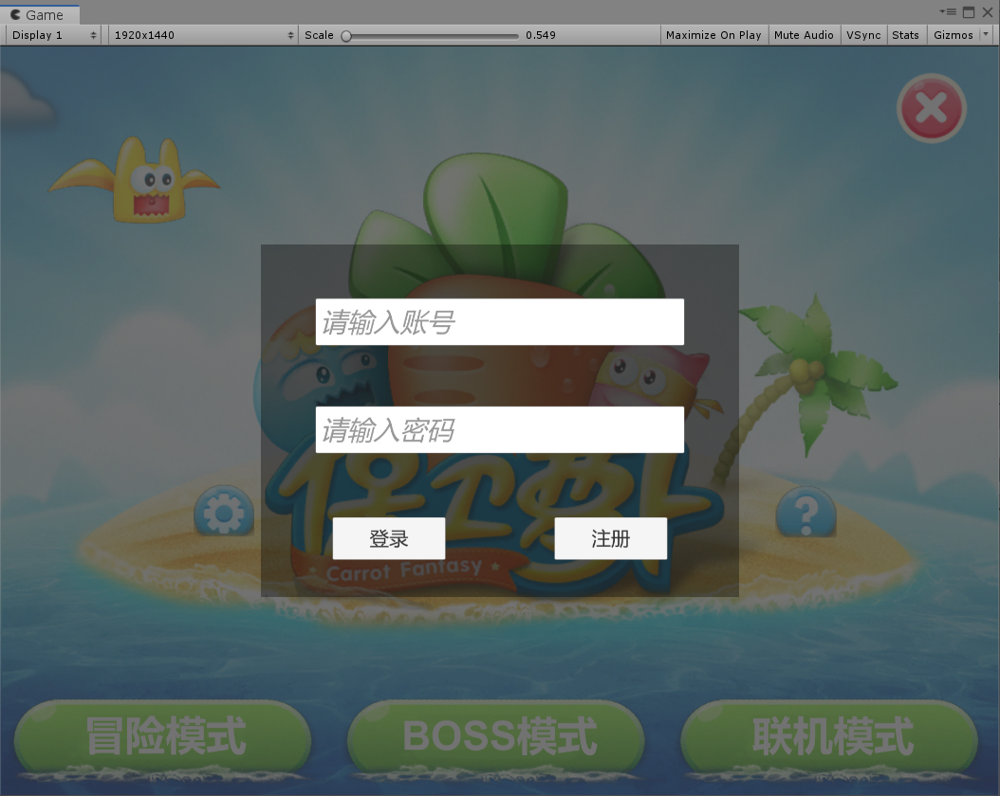
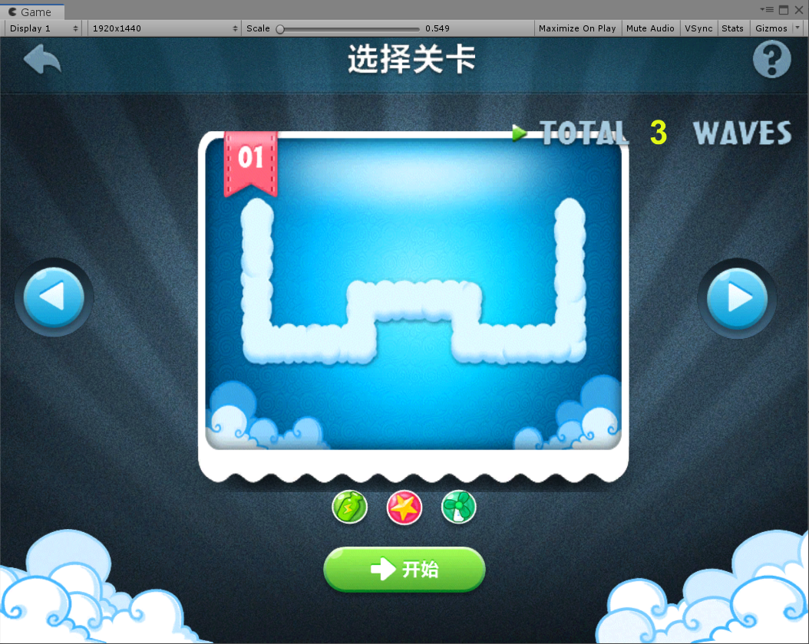
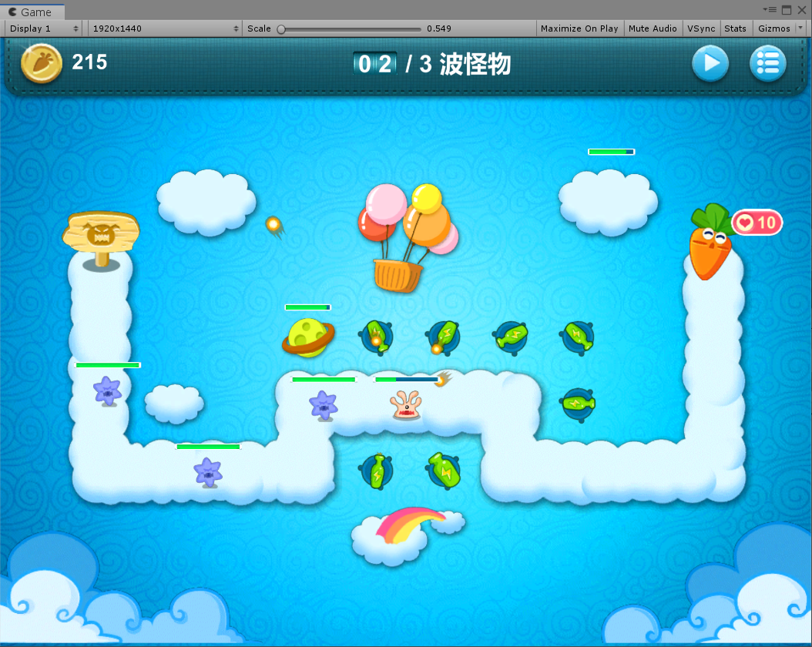
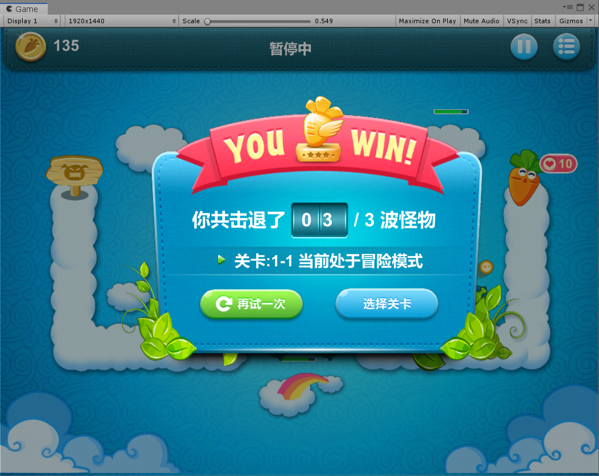

# CarrotFantasyClient1
 保卫萝卜（毕设）

包含客户端与服务端。

**文档索引**见：[Docs/README.md](Docs/README.md)　|　**构建 / 热更日常流程**见：[Docs/构建与热更-操作手册.md](Docs/构建与热更-操作手册.md)

## 热更方案

- **资源热更**：自研 AssetBundle 管线 —— 版本清单 + RSA 清单签名 + MD5 校验 + Pack 合并下载 + 原子切换。
- **代码热更**：**Lua（xLua）** —— 脚本随 AB 下发，解包成散文件后按需 `require`，支持不重启进程热更。

> 历史：曾接入 HybridCLR 做 C# 代码热更，因其 2023 分支要求 Unity ≥ 2023.2、与本工程的 2023.1 不兼容而移除（提交 `8f5926e`）。
> 现状与缺口见 [Docs/AB框架-结构与流程.md](Docs/AB框架-结构与流程.md)。

配表导表推荐入口：`ConfigTools/gen_code_json.bat`。

1.客户端采用Unity和C#语言开发，服务端使用egametang框架辅助开发，网络协议使用ProtoBuf。  
2.客户端采用MVC模式进行业务的开发，使用UGUI与DoTween完成UI的搭建。  
3.核心战斗采用有限状态机进行流程控制，使用观察者模式实现数据与表现分离。  
4.核心战斗采用组件式设计实现游戏功能，如碰撞检测，物体位移。  

效果展示  

